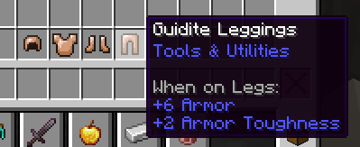
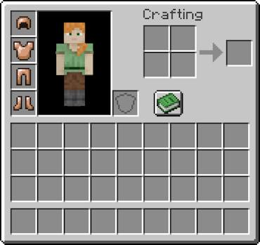
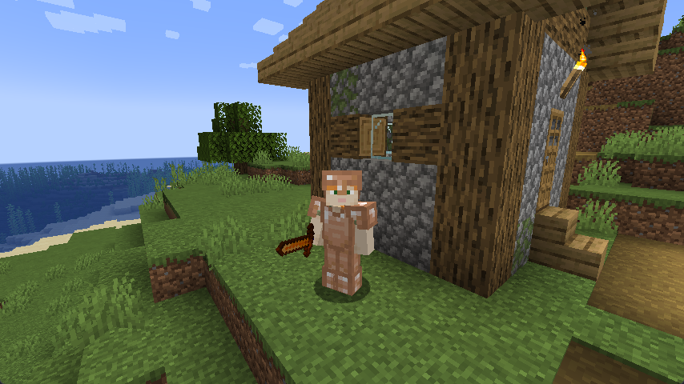

Armor provides the player with increased defense against attacks from mobs and other players.

## Creating an Armor Materials Class {#creating-an-armor-materials-class}

Technically, you don't need a dedicated class for your armor material, but it's good practice anyways with the number of static fields you will need.

For this example, we'll create a `GuiditeArmorMaterial` class to store our static fields.

### Equipment Asset Resource Key {#equipment-asset-resource-key}

Even though we don't have to register our `ArmorMaterial` to any registries, it's generally good practice to store any resource keys as constants, as the game will use this to find the relevant textures for our armor.

<<< @/reference/latest/src/main/java/com/example/docs/item/armor/GuiditeArmorMaterial.java#material_key

We will pass this to the `ArmorMaterial` constructor later.

### `ArmorMaterial` Instance {#armormaterial-instance}

To create our material, we need to create a new instance of the `ArmorMaterial` record, the base durability and material registry key constants will be used here.

<<< @/reference/latest/src/main/java/com/example/docs/item/armor/GuiditeArmorMaterial.java#guidite_armor_material

The `ArmorMaterial` constructor accepts the following parameters, in this specific order:

| Parameter             | Description                                                                                                                                                                                                                                 |
| --------------------- | ------------------------------------------------------------------------------------------------------------------------------------------------------------------------------------------------------------------------------------------- |
| `durability`          | The base durability of all armor pieces, this is used when calculating the total durability of each individual armor piece that uses this material. You can refer to the vanilla `ArmorMaterials` to determine a balanced durability value. |
| `defense`             | A map of `EquipmentType` (an enum representing each armor slot) to an integer value, which indicates the defense value of the material when used in the corresponding armor slot.                                                           |
| `enchantmentValue`    | The "enchantability" of armor items which use this material.                                                                                                                                                                                |
| `equipSound`          | A registry entry of a sound event that is played when you equip a piece of armor which uses this material. For more information on sounds, check out the [Custom Sounds](../sounds/custom) page.                                            |
| `toughness`           | A float value which represents the "toughness" attribute of the armor material - essentially how well the armor will absorb damage.                                                                                                         |
| `knockbackResistance` | A float value which represents the amount of knockback resistance the armor material grants the wearer.                                                                                                                                     |
| `repairIngredient`    | An item tag that represents all items which can be used to repair the armor items of this material in an anvil.                                                                                                                             |
| `assetId`             | An `EquipmentAsset` registry key, this should be the equipment asset registry key constant you created earlier.                                                                                                                             |

We define the repair ingredient tag reference as follows:

<<< @/reference/latest/src/main/java/com/example/docs/item/armor/GuiditeArmorMaterial.java#repair_tag

In order to specify which items can be used in an anvil to repair this material, we will create a tag which holds a list of items. Let's add a new tag to our item tag provider class:

<<< @/reference/latest/src/client/java/com/example/docs/datagen/ExampleModItemTagProvider.java#repair_tags

In our example, we will be using the copper ingot as a repair material for guidite. If you want to create a custom guidite ingot instead, you may [create a custom item](./first-item) and add its ID to the tag.

Now, you'll be able to repair our armor in anvils:

If you're struggling to determine values for any of the parameters, you can consult the vanilla `ArmorMaterial` instances which can be found in the `ArmorMaterials` interface.

## Creating the Armor Items {#creating-the-armor-items}

Now that you've registered the material, you can create the armor items in your `ModItems` class:

Obviously, an armor set doesn't need every type to be satisfied, you can have a set with just boots, or leggings etc. - the vanilla turtle shell helmet is a good example of an armor set with missing slots.

There are two sub-categories of armor items you can create, humanoid armor and non-humanoid armor.

::: tabs

== Humanoid Armor Items

Humanoid armor refers to the armors which are worn by humanoid entities such as players, zombies, skeletons, etc. They are created using the `Item.Properties().humanoidArmor()` method.

<<< @/reference/latest/src/main/java/com/example/docs/item/ModItemIds.java#create_armor_items_humanoid

<<< @/reference/latest/src/main/java/com/example/docs/item/ModItems.java#create_armor_items_humanoid

== Non-Humanoid Armor Items

Non-humanoid armor refers to the armors which are worn by non-humanoid entities such as horses, nautiluses, etc. They are created using methods unique to the non-humanoid mob.

In this guide, we will create a horse and a nautilus armor item, which are created using the `Item.Properties().horseArmor()` and `Item.Properties().nautilusArmor()` methods respectively.

<<< @/reference/latest/src/main/java/com/example/docs/item/ModItemIds.java#create_armor_items_non_humanoid

<<< @/reference/latest/src/main/java/com/example/docs/item/ModItems.java#create_armor_items_non_humanoid

:::

You will also need to [add the items to a creative tab](./custom-creative-tabs) if you want them to be accessible from the inventory.

As with all items, you should create translation keys for them as well.

## Textures and Models {#textures-and-models}

You will need to create a set of textures for the items, and a set of textures for the actual armor when it's worn by a "humanoid" entity or a "non-humanoid" entity.

### Item Textures and Model {#item-textures-and-model}

These textures are no different to other items - you must create the textures, and create a generic generated item model - which was covered in the [Creating Your First Item](./first-item#adding-a-texture-and-model) guide.

For example purposes, you may use the following textures and model JSON as a reference.

<DownloadEntry visualURL="/assets/develop/items/armor_0.png" downloadURL="/assets/develop/items/example_armor_item_textures.zip">Item Textures</DownloadEntry>

::: info

You will need model JSON files for all the items, not just the helmet, it's the same principle as other item models.

:::

<<< @/reference/latest/src/main/generated/assets/example-mod/models/item/guidite_helmet.json

As you can see, in-game the armor items should have suitable models:

### Armor Textures {#armor-textures}

When an entity wears your armor, nothing will be shown. This is because you're missing textures and the equipment model definitions.

::: info

Note that since version 26.1, the armor texture for baby humanoids is no longer a scaled down version of the adult humanoid texture. Instead, it's a texture that must be provided separately.

:::

There are three layers for the armor texture, that must be present.

Previously, we created a `ResourceKey<EquipmentAsset>` constant called `GUIDITE_ARMOR_MATERIAL_KEY` which we passed into our `ArmorMaterial` constructor. It's recommended to name the texture similarly, so in our case, `guidite.png`

- `assets/example-mod/textures/entity/equipment/humanoid/guidite.png` - Contains upper body and boot textures.
- `assets/example-mod/textures/entity/equipment/humanoid_leggings/guidite.png` - Contains legging textures.
- `assets/example-mod/textures/entity/equipment/humanoid_baby/guidite.png` - Contains the texture for baby humanoid.
- `assets/example-mod/textures/entity/equipment/horse/guidite.png` - Contains the texture for horse armor.
- `assets/example-mod/textures/entity/equipment/nautilus/guidite.png` - Contains the texture for nautilus armor.

<DownloadEntry downloadURL="/assets/develop/items/example_armor_layer_textures.zip">Guidite Armor Model Textures</DownloadEntry>

Next, you'll need to create an associated equipment model definition. These go in the `/assets/example-mod/equipment/` folder.

The `ResourceKey<EquipmentAsset>` constant we created earlier will determine the name of the JSON file. In this case, it'll be `guidite.json`.

Since we are adding "humanoid" (helmet, chestplate, leggings, boots) and "non-humanoid" (horse, nautilus) armor pieces, our equipment model definition will look like this:

<<< @/reference/latest/src/main/resources/assets/example-mod/equipment/guidite.json

With the textures and equipment model definition present, you should be able to see your armor on entities that wear it:

::: tabs

== Humanoid

== Non-humanoid

:::

<!-- TODO: Fix the TODO below. -->
<!-- TODO: A guide on creating equipment for dyeable armor could prove useful. -->

## Tagging Armor Items {#tags}

::: info PREREQUISITES

For more information, see the documentation on generating [item tags](../data-generation/tags).

:::

It's also recommended to place your armor humanoid pieces in the appropriate item tags. Humanoid armor pieces have their own individual tags, such as `ItemTags.CHEST_ARMOR`, which are used for enchantability.

In your item tag provider, add the following lines to `addTags`:

<<< @/reference/latest/src/client/java/com/example/docs/datagen/ExampleModItemTagProvider.java#armor_tags
