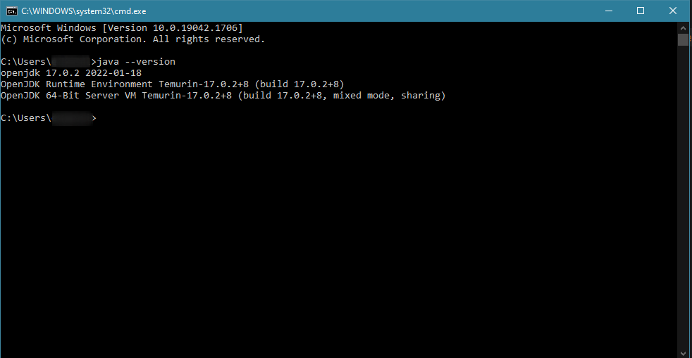

Once the installation is complete, you can verify that Java 25 is installed by opening the command prompt again and typing `java -version`.

If the command runs successfully, you will see something like shown before, where the Java version is displayed:

If you encounter any issues, feel free to ask for help in the [Fabric Discord](https://discord.fabricmc.net/) in the `#player-support` channel.
