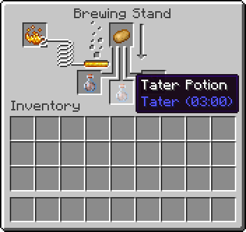

Tränke sind Verbrauchsmaterialien, die Entitäten Statuseffekte geben können. Spieler können Tränke mit einem Braustand brauen oder durch andere Spielmechaniken erhalten.

## Benutzerdefinierte Tränke {#custom-potions}

Genauso wie Items und Blöcke, müssen auch Tränke registriert werden.

## Deine Trank ID-Klassen vorbereiten {#preparing-your-potion-id-class}

Wenn du die Seite [Erstellen deines ersten Items](../items/first-item) bereits durchgearbeitet hast, wird dir dieser Vorgang sehr vertraut vorkommen - du musst Klassen erstellen, um die Identifikatoren deiner `Potion`s, die als `ResourceKey` gespeichert werden, zu speichern.

Diese Verweise auf den Trank werden für [Tags zur Datengenerierung für Tränke](../data-generation/tags) verwendet.

Diese Methode kann in eine Klasse namens `ModPotionIds` (oder einen beliebigen anderen Namen) eingefügt werden.

::: tip

Mojang macht dies auch mit ihren Tränken! Sieh dir die Klasse `PotionIds` für eine Inspiration an.

:::

<<< @/reference/latest/src/main/java/com/example/docs/potion/ModPotionIds.java#mod_potion_ids_class

### Den Trank erstellen {#creating-the-potion}

Lasst uns mit der Deklaration eines Feldes, welches eine Instanz von `Potion` hält. Wir werden hierfür die `ModInitializer` implementierende Klasse nutzen. Beachte die Verwendung von `Registry.registerForHolder`, da die meisten Vanilla-Methoden, die Tränke verwenden, diese wie Mob-Effekte als Halter bevorzugen.

<<< @/reference/latest/src/main/java/com/example/docs/potion/ExampleModPotions.java#register_potion

Es wird eine Instanz der `MobEffectInstance` benutzt, die drei Parameter besitzt:

- `Holder<MobEffect> effect` - Ein Effekt, repräsentiert als ein Halter. Hier verwenden wir unseren benutzerdefinierten Effekt. Alternativ kannst du auf Vanilla-Effekte über die Klasse `MobEffects` von Vanilla zugreifen.
- `int duration` - Länge des Effekts in Spielticks.
- `int amplifier` - Die Stärke des Effekts. Eile II hätte zum Beispiel einen amplifier-Wert von 1.

::: info

Um deinen eigenen Effekt zu erstellen, schau bitte in den Leitfaden [Effekte](../entities/effects).

:::

### Das Rezept generieren {#registering-the-potion}

:::info VORAUSSETZUNGEN

Dieser Leitfaden verweist auf [die Datengenerierung für Rezepte](../data-generation/recipes). Dies ist auch ohne Datengenerierung möglich, doch da für Tränke eine große Anzahl von JSON-Dateien erforderlich ist, wird wie immer die Verwendung des Datengenerators empfohlen.

:::

In der Methode `buildRecipes` eines Rezeptprovider werden wir einen neuen `FabricBrewingProvider` erstellen und `FabricBrewingProvider#buildRecipes` aufrufen, um ein neues Trankrezept zu generieren.

`FabricBrewingProvider` stellt die Methode `buildMixes` bereit, die die eigentlichen Werkrezepte verarbeitet. Du wirst `buildMix` mit 3 Parametern aufrufen:

- `Holder<Potion> input` - Der Starttrank, repräsentiert durch einen Halter. Tränke, die mit Seltsamen Tränken erstellt wurden, sollten stattdessen möglicherweise `buildStartMix` verwenden, wodurch ebenfalls das erwartete Rezept Wasserflasche -> Gewöhnlicher Trank für deine Reagenz generiert wird.
- `Item reagent` - Die Hauptzutat des Tranks.
- `Holder<Potion> output` - Der daraus entstandene Trank, dargestellt durch einen Holder.

<<< @/reference/latest/src/client/java/com/example/docs/datagen/ExampleModBrewingProvider.java#register_recipes

Nachdem du die Datengenerierung ausgeführt hast, kannst du mit einer Kartoffel einen Kartoffeltrank brauen.

