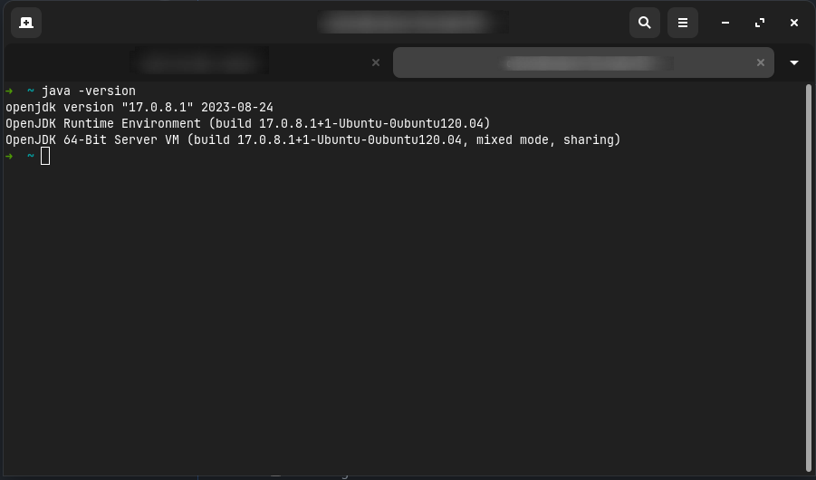

Ce guide vous expliquera comment installer Java 25 sous Linux.

Le lanceur Minecraft intègre sa propre installation Java ; cette section ne vous concerne donc que si vous souhaitez utiliser le programme d'installation basé sur le fichier `.jar` de Fabric, ou si vous souhaitez utiliser le fichier `.jar` du serveur Minecraft.

## 1. Vérification de si Java est déjà installé {#1-check-if-java-is-already-installed}

Ouvrez un terminal, entrez `java -version`, et pressez <kbd>Entrer</kbd>.



::: warning

Pour utiliser Minecraft 26.1, vous avez besoin d'avoir au moins la version 25 de Java installée.

Si cette commande affiche un numéro de version inférieur à 25, vous devez mettre à jour votre installation actuelle de Java ; continuez de lire cette page.

:::

## 2. Téléchargement et installation de Java 25 {#2-downloading-and-installing-java}

Nous recommandons d'utiliser OpenJDK 25, qui est disponible pour la plupart des distributions Linux.

### Arch Linux {#arch-linux}

::: info

Pour plus d'information sur l'installation de Java sous Arch Linux, consultez le [Wiki d'Arch Linux](https://wiki.archlinux.org/title/Java).

:::

Vous pouvez installer le dernier JRE depuis les dépôts officiels:

```sh
sudo pacman -S jre-openjdk
```

Si vous faites tourner un serveur sans besoin d'interface graphique, vous pouvez installer la version sans affichage à la place :

```sh
sudo pacman -S jre-openjdk-headless
```

Si vous prévoyez de développer des mods, vous aurez du JDK à la place :

```sh
sudo pacman -S jdk-openjdk
```

### Debian/Ubuntu {#debian-ubuntu}

Vous pouvez installer Java 25 en utilisant `apt` avec les commandes suivantes :

```sh
sudo apt update
sudo apt install openjdk-25-jdk
```

### Fedora {#fedora}

Vous pouvez installer Java 25 en utilisant `dnf` avec les commandes suivantes :

```sh
sudo dnf install java-25-openjdk
```

Si vous n'avez pas besoin d'interface graphique, vous pouvez installer la version sans affichage à la place :

```sh
sudo dnf install java-25-openjdk-headless
```

Si vous prévoyez de développer des mods, vous aurez du JDK à la place :

```sh
sudo dnf install java-25-openjdk-devel
```

### Autres distributions Linux {#other-linux-distributions}

Si votre distribution n'est pas listée ci-dessus, vous pouvez télécharger le dernier JRE sur [Adoptium](https://adoptium.net/installation/linux)

Il est recommandé de se référer à un guide alternatif pour votre distribution si vous souhaitez développer des mods.

## 3. Vérifier que Java 25 est bien installé {#3-verify-that-java-is-installed}

Lorsque l'installation est terminée, vous pouvez vérifier que Java 25 est installé en ouvrant un terminal et en entrant `java -version`.

Si la commande s'exécute correctement, vous verrez s'afficher un message similaire à celui présenté précédemment, dans lequel la version de Java est indiquée :


