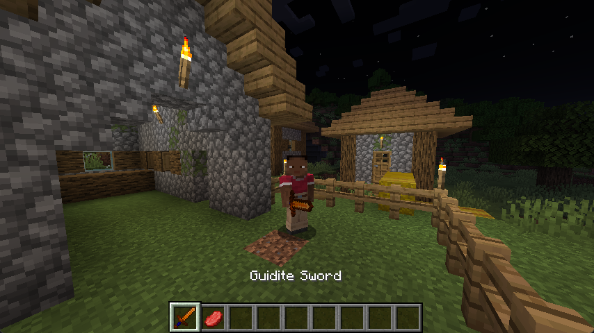

Інструменти необхідні для виживання та прогресу, дозволяючи гравцям збирати ресурси, будувати будівлі та захищатися.

## Створення інструментального матеріалу {#creating-a-tool-material}

Ви можете створити матеріал інструменту, створивши екземпляр нового об’єкта `ToolMaterial` і зберігши його в полі, яке можна використовувати пізніше для створення предметів інструменту, які використовують матеріал.

<<< @/reference/latest/src/main/java/com/example/docs/item/ModItems.java#guidite_tool_material

Конструктор `ToolMaterial` приймає такі параметри в такому конкретному порядку:

| Параметр                  | Опис                                                                                                                                                                                                                         |
| ------------------------- | ---------------------------------------------------------------------------------------------------------------------------------------------------------------------------------------------------------------------------- |
| `incorrectBlocksForDrops` | Якщо блок знаходиться в неправильному теґу `incorrectBlocksForDrops`, це означає, що коли ви використовуєте інструмент, виготовлений із цього `ToolMaterial` на цьому блоці, блок не скине жодних предметів. |
| `durability`              | Міцність усіх інструментів із цього `ToolMaterial`.                                                                                                                                                          |
| `speed`                   | Швидкість добування інструментів із цього `ToolMaterial`.                                                                                                                                                    |
| `attackDamageBonus`       | Інструменти з цього `ToolMaterial` матимуть додаткову шкоду від атаки.                                                                                                                                       |
| `enchantmentValue`        | «Зачаровуваність» інструментів, які є з цього `ToolMaterial`.                                                                                                                                                |
| `repairItems`             | Будь-які предмети в цьому теґу можна використовувати для лагодження інструментів цього `ToolMaterial` у ковадлі.                                                                                             |

Для цього прикладу ми будемо використовувати той самий теґ предмета лагодження, який будемо використовувати для обладунків. Ми визначаємо посилання на теґ наступним чином:

<<< @/reference/latest/src/main/java/com/example/docs/item/armor/GuiditeArmorMaterial.java#repair_tag

Якщо вам важко визначити збалансовані значення для будь-якого з числових параметрів, вам слід розглянути константи інструментального матеріалу, такі як `ToolMaterial.STONE` або `ToolMaterial.DIAMOND`.

### Створення теґу матеріалу інструмента {#creating-the-tool-material-tag}

Для нашого теґу `incorrectBlocksForDrops` ми можемо створити теґ, схожий на стандартний теґ `minecraft:incorrect_for_*_drops`, який визначає блоки, які **не** випадуть під час добування за допомогою матеріалу. Визначмо посилання на теґ наступним чином:

<<< @/reference/latest/src/main/java/com/example/docs/item/ModItems.java#guidite_incorrect_blocks_tag

Далі ми визначаємо вміст теґу за допомогою теґу JSON. Зробімо ґуїдинові інструменти здатними добувати ті самі блоки, що й дерев’яні інструменти, а також мідну руду та глибосланцеву мідну руду:

<<< @/reference/latest/src/main/resources/data/example-mod/tags/block/incorrect_for_guidite_tool.json

Зауважте, що цей приклад успадковує слабший матеріал інструмента і _видаляє_ записи, які наш сильніший матеріал може добувати, успадковуючи всі інші блоки, які не може добути дерево.

::: tip

Ми також могли б зробити навпаки: успадкувати від потужнішого інструмента та _додати_ додаткові блоки, для яких гуїдитові інструменти непридатні.

Наприклад, якщо ми хочемо створити інструмент, який працював би як залізо, але не міг добувати діамантову руду, `values` мав би містити `#minecraft:incorrect_for_iron_tool` і `#minecraft:diamond_ores`.

Якщо ви хочете, щоб ваш матеріал інструмента добував ті самі блоки, що й наявний, ви можете включити відповідний теґ у визначенні вашого теґу без будь-яких доповнень чи видалень. Це рекомендовано замість передачі наявного теґу як `incorrectBlocksForDrops` вашого матеріалу, щоб користувачі могли налаштувати неправильні блоки для кожного матеріалу незалежно.

:::

## Реєстрація предметів інструментів {#registering-tool-items}

Ви можете створювати власні предмети-інструменти, використовуючи ті самі класи та функції, що й у [створенні вашого першого предмета](./first-item):

:::: tabs

== Меч

Параметри з рухомою комою стосуються шкоди від атаки та швидкості атаки відповідно.

<<< @/reference/latest/src/main/java/com/example/docs/item/ModItemIds.java#guidite_sword

<<< @/reference/latest/src/main/java/com/example/docs/item/ModItems.java#guidite_sword

== Спис

Параметри з рухомою комою стосуються, відповідно, тривалості атаки, множника шкоди, затримки, часу спішування, порогового значення для спішування, тривалості відкидання, порогового значення для відкидання, моменту завдання шкоди та порогового значення для завдання шкоди.

<<< @/reference/latest/src/main/java/com/example/docs/item/ModItemIds.java#guidite_spear

<<< @/reference/latest/src/main/java/com/example/docs/item/ModItems.java#guidite_spear

== Кайло

Параметри з рухомою комою стосуються шкоди від атаки та швидкості атаки відповідно.

<<< @/reference/latest/src/main/java/com/example/docs/item/ModItemIds.java#guidite_pickaxe

<<< @/reference/latest/src/main/java/com/example/docs/item/ModItems.java#guidite_pickaxe

== Сокира

Для сокир слід створити `AxeItem` замість загального `Item`. Це реалізує дії, що виконуються за допомогою ПКМ, специфічні для сокири, а також автоматично викликає метод `axe` `Item.Properties`.

Параметри з рухомою комою стосуються шкоди від атаки та швидкості атаки відповідно.

<<< @/reference/latest/src/main/java/com/example/docs/item/ModItemIds.java#guidite_axe

<<< @/reference/latest/src/main/java/com/example/docs/item/ModItems.java#guidite_axe

== Лопата

Для лопат слід створити `ShovelItem` замість загального `Item`. Це реалізує дії, що виконуються за допомогою ПКМ, специфічні для лопати, а також автоматично викликає метод `shovel` `Item.Properties`.

Параметри з рухомою комою стосуються шкоди від атаки та швидкості атаки відповідно.

<<< @/reference/latest/src/main/java/com/example/docs/item/ModItemIds.java#guidite_shovel

<<< @/reference/latest/src/main/java/com/example/docs/item/ModItems.java#guidite_shovel

== Мотика

Для мотик слід створити `HoeItem` замість загального `Item`. Це реалізує дії, що виконуються за допомогою ПКМ, специфічні для мотики, а також автоматично викликає метод `hoe` `Item.Properties`.

Параметри з рухомою комою стосуються шкоди від атаки та швидкості атаки відповідно.

<<< @/reference/latest/src/main/java/com/example/docs/item/ModItemIds.java#guidite_hoe

<<< @/reference/latest/src/main/java/com/example/docs/item/ModItems.java#guidite_hoe

::::

Не забудьте додати їх до вкладок творчості, якщо ви хочете отримати доступ до них з інвентарю творчості!

<<< @/reference/latest/src/main/java/com/example/docs/item/ModItems.java#add_guidite_sword_to_create_tab

Вам також доведеться додати текстуру, переклад предмета та модель предмета. Однак для моделі item ви захочете використовувати модель `item/handheld` як батьківську модель замість звичайної `item/generated`.

## Assets {#models}

:::: tabs

::::

Вам також потрібно буде додати [текстуру](./first-item#adding-a-texture), [переклад](./first-item#naming-the-item), [клієнтський переклад](./first-item#creating-the-client-item) і [модель предмета](./item-models). Однак для моделі item ви захочете використовувати модель `item/handheld` як батьківську модель замість звичайної `item/generated`.

::: info

Наведені нижче моделі створені з використанням генерації даних. Щоб отримати додаткові відомості, перегляньте документацію щодо [генерації моделей предметів](../data-generation/item-models).

:::

::: tabs

== Меч

<<< @/reference/latest/src/client/java/com/example/docs/datagen/ExampleModModelProvider.java#guidite_sword

== Спис

<<< @/reference/latest/src/client/java/com/example/docs/datagen/ExampleModModelProvider.java#guidite_spear

== Кайло

<<< @/reference/latest/src/client/java/com/example/docs/datagen/ExampleModModelProvider.java#guidite_pickaxe

== Сокира

<<< @/reference/latest/src/client/java/com/example/docs/datagen/ExampleModModelProvider.java#guidite_axe

== Лопата

<<< @/reference/latest/src/client/java/com/example/docs/datagen/ExampleModModelProvider.java#guidite_shovel

== Мотика

<<< @/reference/latest/src/client/java/com/example/docs/datagen/ExampleModModelProvider.java#guidite_hoe

:::

Ось усі приклади текстур, використані в цьому посібнику:

<DownloadEntry downloadURL="/assets/develop/items/tools.zip">Текстури гайдитових інструментів</DownloadEntry>

## Додання предметів інструментів до теґу {#tags}

:::info ПЕРЕДУМОВИ

Щоб отримати додаткові відомості, перегляньте документацію щодо створення [теґів предмета](../data-generation/tags).

:::

Також рекомендується розміщувати інструмент у відповідних теґах предметів. Інструменти мають власні індивідуальні теґи, такі як `ItemTags.SWORDS`, які використовуються для зачаровуваності та іншої специфічної логіки, наприклад, чи потрібно завдавати нищівну атаку.

У вашому постачальнику теґів предмета додайте такі рядки до `addTags`:

<<< @/reference/latest/src/client/java/com/example/docs/datagen/ExampleModItemTagProvider.java#tool_tags

Це майже все! Якщо ви зайдете в гру, ви побачите свої інструменти на вкладці «Інструменти й прилади» в меню інвентарю творчости.

