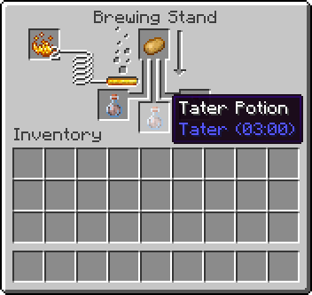

药水是能为实体提供效果的消耗品。玩家可以使用酿造台酿造药水，或者从其他游戏机制中以物品形式获取。

## 自定义药水{#custom-potions}

和物品和方块一样，药水需要注册。

## 准备你的药水 ID 类 {#preparing-your-potion-id-class}

如果你已经完成了[创建你的第一个物品](../items/first-item)页面，那么这个过程对你来说会非常熟悉——你需要创建类来保存你的 `Potion` 的标识符，这些标识符存储为 `ResourceKey`。

这些对药水的引用用于[生成药水标签的数据](../data-generation/tags)。

你可以将此方法放在一个名为 `ModPotionIds` 的类中（或者你想给类起什么名字都行）。

::: tip

Mojang对药水也是这么做的！参考 `PotionIds` 类来获取灵感。

:::

<<< @/reference/latest/src/main/java/com/example/docs/potion/ModPotionIds.java#mod_potion_ids_class

### 创建物品{#creating-the-potion}

让我们从声明一个用于储存你的 `Potion` 实例的字段开始。我们将直接使用 `ModInitializer`——实现这个类来持有这个字段。注意使用了 `Registry.registerForHolder`，就像生物效果一样，许多使用药水的原版方法都优先使用这些作为 holder。

<<< @/reference/latest/src/main/java/com/example/docs/potion/ExampleModPotions.java#register_potion

我们传入一个 `MobEffectInstance` 实例，它的构造方法接收以下 3 个参数：

- `Holder<MobEffect> effect` - 效果，表现为一个 holder。我们在这里使用我们的自定义效果。或者，你也可以通过原版的 `MobEffects` 类访问原版效果。
- `int duration` - 状态效果的持续时间（以刻计算）。
- `int amplifier` - 状态效果的增幅。比如 急迫 II 的增幅是 1。

::: info

要创建自己的药水效果，请使用[效果](../entities/effects)指南。

:::

### 生成配方 {#registering-the-potion}

:::info 前置知识

本指南参考了[配方的数据生成](../data-generation/recipes)。这也可以不使用数据生成来完成，但药水需要大量的 JSON 文件，因此一如既往地推荐使用数据生成。

:::

在配方提供器的 `buildRecipes` 方法中，我们将创建一个新的 `FabricBrewingProvider`，并调用 `FabricBrewingProvider#buildRecipes` 来生成一个新的药水配方。

`FabricBrewingProvider` 提供了 `buildMixes` 方法，用于处理实际的合成配方。你将使用 3 个参数来调用 `buildMix`：

- `Holder<Potion> input` - 初始药水，表现为一个 holder。由粗制的药水制作的药水，可能希望改用 `buildStartMix`，这也会为你的试剂生成预期的 水瓶 -> 平凡的药水 配方。
- `Item reagent` - 药水的主要成分。
- `Holder<Potion> output` - 生成的药水，表现为一个 holder。

<<< @/reference/latest/src/client/java/com/example/docs/datagen/ExampleModBrewingProvider.java#register_recipes

运行数据生成后，你可以使用马铃薯酿造一瓶马铃薯药水。

